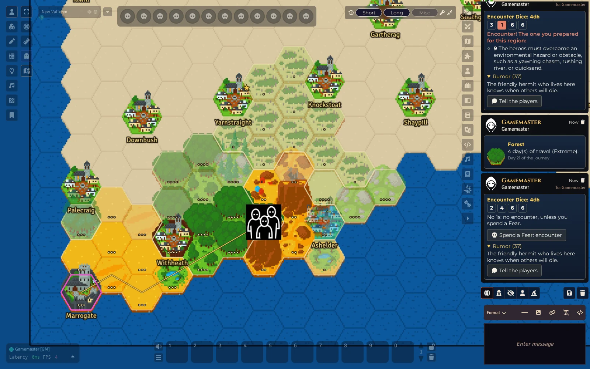
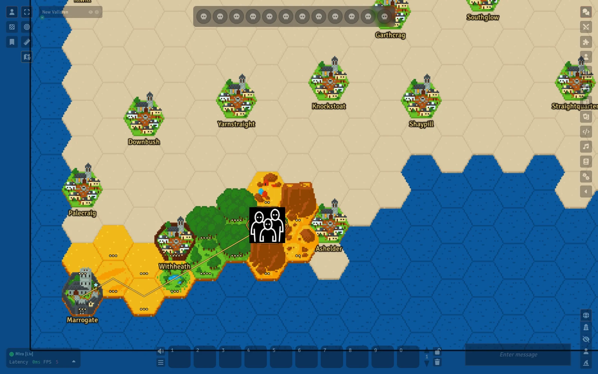
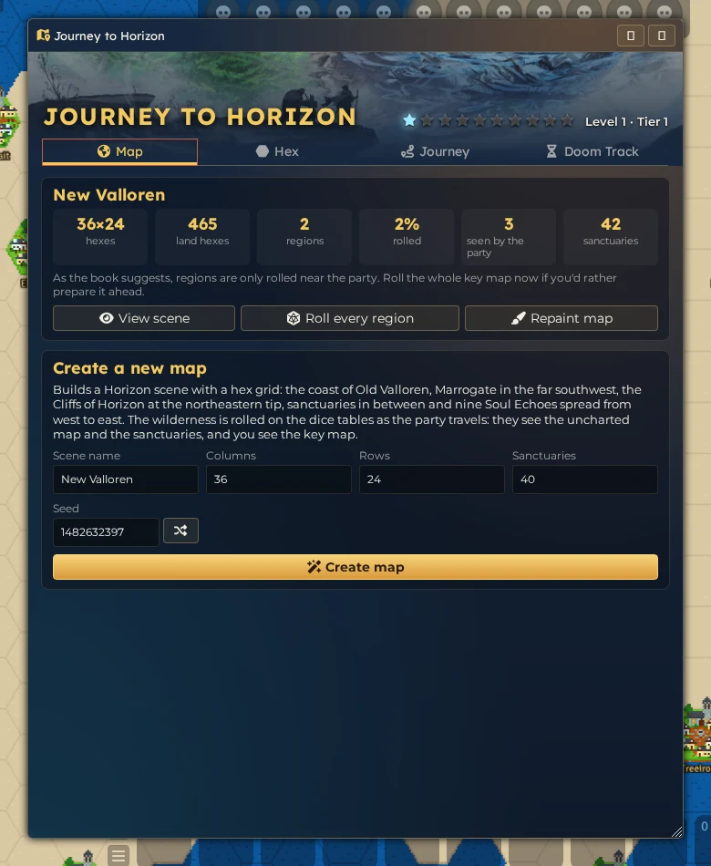
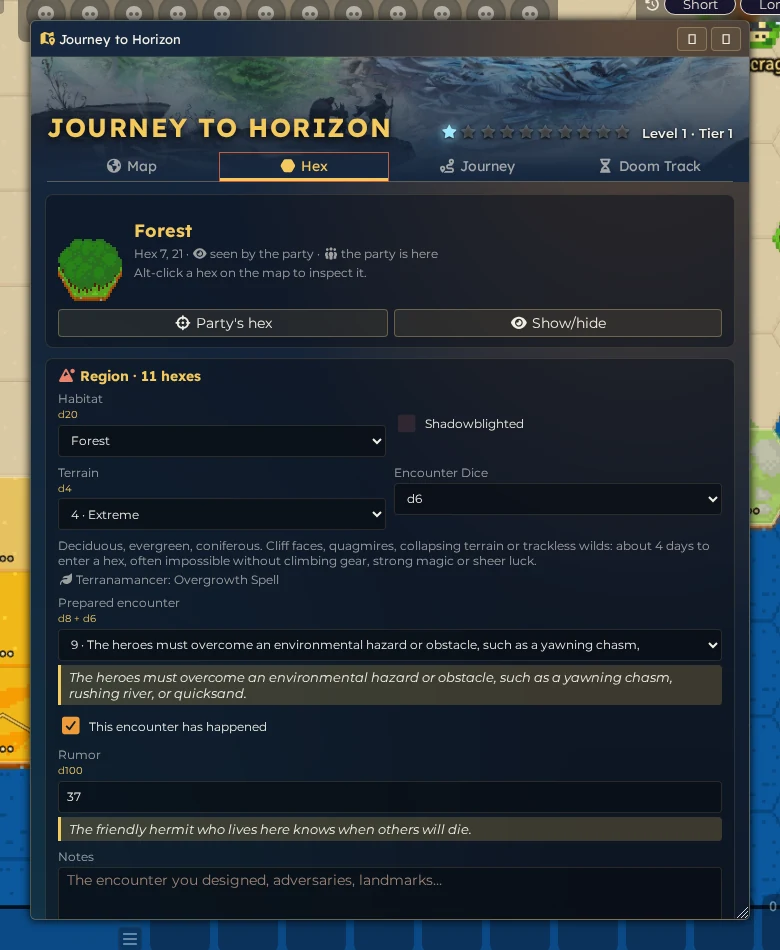
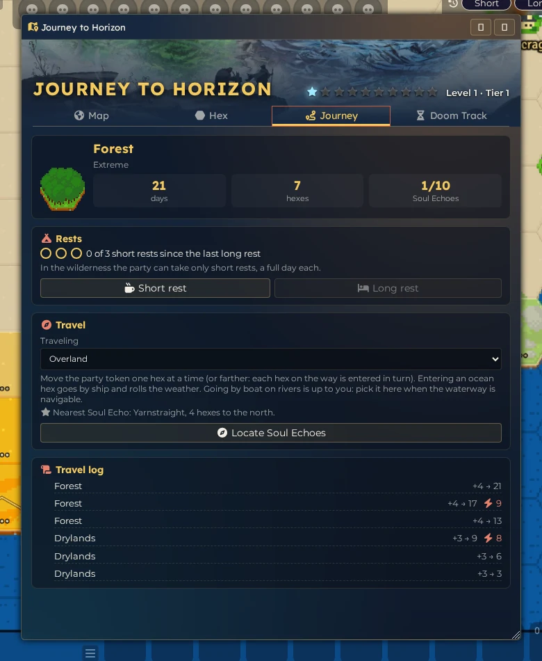
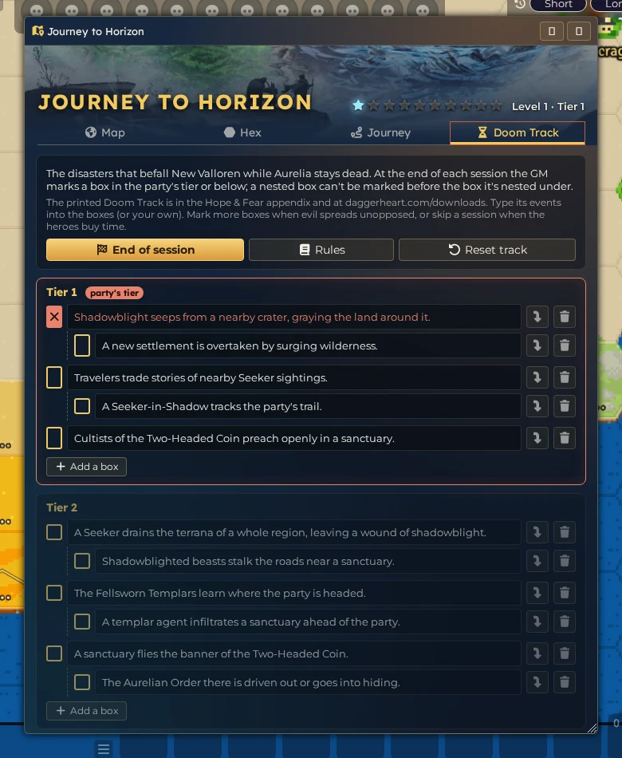
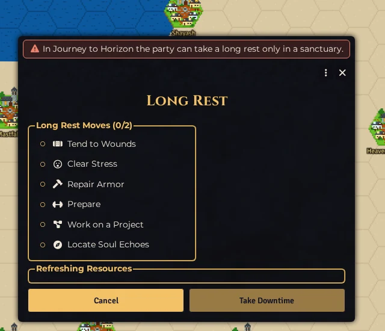

# Horizon: Journey to Horizon Hex Crawl

A Foundry VTT module for running the **Journey to Horizon** campaign frame of [Daggerheart: Hope & Fear](https://www.daggerheart.com). It builds the hex map of New Valloren on the fly from the campaign's dice tables and runs the journey hex by hex: travel days, Encounter Dice, ocean weather, rests, Soul Echoes and the Doom Track. The GM sees the key map; the players see the uncharted continent and the land they've crossed.



## Requirements

- [**Foundry VTT**](https://foundryvtt.com/) v14
- [**Daggerheart**](https://foundryborne.online/) system 2.12 or later
- [**Daggerheart: Hope & Fear**](https://www.foundryvtt.store/products/daggerheart-hope-and-fear) module (`daggerheart-hope-and-fear`): the Journey to Horizon rules this module links to and the art of its app. Horizon doesn't include that content itself.
- Optional: [**Dice So Nice**](https://foundryvtt.com/packages/dice-so-nice) for 3D Encounter Dice, ocean weather and Endurance rolls

Horizon can't be active together with Hotpot (`dh-hotpot`), Five Banners (`dh-5banners`) or Weredragon (`dh-weredragon`). Run one campaign frame module at a time.

## Installation

In Foundry's **Add-on Modules → Install Module**, paste this manifest URL:

```
https://github.com/emberite/dh-horizon/releases/latest/download/module.json
```

## Screenshots

| | |
|---|---|
|  |  |
| **The GM's key map:** rolled regions (faded until the party sees them), region outlines, terrain dots, Soul Echoes (gold stars) and the GM-only encounter cards. | **The players' map:** Old Valloren's coast and sanctuaries, plus every hex the party has stood in or next to. |
|  |  |
| **Map:** pick the size, the number of sanctuaries and a seed, and the scene is built. | **Hex:** Alt-click any hex to see and edit its region: habitat, terrain, prepared encounter, rumor, notes. |
|  |  |
| **Journey:** where the party is, days on the road, short rests left, Soul Echoes, level and tier, and the travel log. | **Doom Track:** mark a box at the end of each session, in the party's tier or below, nested boxes after their parent. |
|  | |
| **Resting:** the Locate Soul Echoes downtime move, and a warning when a long rest isn't possible. | |

## Features

### Hex crawl map builder (GM)

Open it from the **Journey to Horizon** section of the Daggerheart sidebar menu, the map button in the token controls of a Horizon scene, or with `game.modules.get('dh-horizon').api.open()`.

**Create map** builds a new scene with a flat-topped hex grid (1 hex ≈ 24 miles):

- a continent stretched from **Marrogate** in the far southwest to the **Cliffs of Horizon** at the northeastern tip, with bays, inland seas and islands;
- sanctuaries spread over the land, with random names from the *Settlement Name (d100×2)* table;
- nine **Soul Echoes** placed as the book suggests: spread fairly evenly from west to east, not in a predictable line;
- the party token on Marrogate.

The **wilderness is rolled on the fly**, as the book's tip recommends: whenever the party comes within the *preparation radius* (2 hexes by default), new regions are rolled for the hexes around it on the *Dice Tables for Mapping Wilderness Regions*:

| Roll | Table |
|---|---|
| d20 | Habitat, with a reroll for Shadowblighted regions (a second 1 means the region is completely overtaken) |
| d12 | Region size: that many contiguous hexes, grown so they don't encircle empty hexes |
| d8 + d6 | The encounter prepared for the region |
| d4 | Terrain: days to enter a hex (Optimal 1, Fair 2, Rough 3, Extreme 4) |
| d100 | A rumor about the region |

Sanctuaries are rolled on the *Dice Tables for Creating Sanctuaries* (trade, quirk, crisis, drive, political system, size, population) when the party comes near them. **Roll every region** fills the whole key map at once if you prefer to prepare ahead.

The scene is drawn with hex tiles. Each rolled hex is a Tile that stays hidden from players until the party has seen it, so the GM sees the key map (faded where the players can't see it yet) while the players see what they've explored. Shadowblighted regions are drawn in gray, with the book's ✕ mark, and every hex shows its terrain rating as 1–4 dots.

In the **Hex** tab (Alt-click a hex on the map) you can change anything: habitat, shadowblight, terrain, Encounter Dice size (d4 for more dangerous areas, d8 for safer ones), the prepared encounter, the rumor and your notes. You can re-roll a region, start a new region from a hex, show or hide hexes and regions, add or remove sanctuaries, move Soul Echoes, and travel to or place the party on the hex.

### The journey

Move the party token. For each hex entered on the way, Horizon:

1. counts the **travel days** from the terrain rating. Boats going downstream save a day and upstream cost one (choose the mode in the Journey tab when a waterway is navigable). Entering an **ocean** hex goes by ship and rolls the **weather** (d4: tailwind, fair, rough, extreme);
2. reveals the hex and the hexes next to it, and rolls new regions ahead;
3. rolls the **Encounter Dice** (one per point of terrain rating). On any 1, the GM gets the encounter prepared for the region, or a fresh roll on the Encounter table if that one has already happened. Otherwise the card offers **Spend a Fear: encounter**. Encounter 4 offers *Gain a Fear per PC*, encounter 12 *Each PC gains a Hope*, and the card's rumor can be shared with the players in one click.

The public chat card shows where the party is and the day of the journey. The dice, encounter, rumor and notes go to a GM-only card.

### Rests, Soul Echoes and levels

- **Rests:** outside a sanctuary the party can take only short rests, each a full day, and at most three in a row. Long rests are only possible in a sanctuary. The Journey tab tracks this, and the system's rest dialog shows a warning when a rest breaks these rules.
- **Locate Soul Echoes:** the campaign's special downtime move is added to both rest dialogs (and as an action on the **Vessel of Light** item). Taking it tells the table the direction of the nearest sanctuary with a Soul Echo, or of Horizon once all ten are gathered. It also reminds the GM that nearby Seekers-in-Shadow may have heard.
- **Soul Echoes:** at a sanctuary with an Echo, **Add its Echo to the Vessel**. The party levels up with every new Echo (level = Echoes in the Vessel, 1–10), and the app shows the party's tier, which the Doom Track uses.
- **Endurance Countdowns** (optional rule, off by default): when the party enters a wilderness hex, each PC rolls their Hope Die. A result equal to or lower than the countdown marks a Stress, a higher result ticks the countdown down, and when it triggers the PC is Vulnerable until the next rest.

### Doom Track

Every tier has its boxes, and boxes can have nested boxes. **End of session** reminds you to mark one in the party's tier or below, and a nested box can only be marked after the box it's nested under. Marked events are posted to chat. Players see the marked boxes (configurable). The printed track is in the Hope & Fear appendix, so the default boxes are starting points drawn from the campaign frame: type the book's events, or your own, into them.

### Compendiums

| Compendium | Contents |
|---|---|
| **Horizon Features & Conditions** | **Shadowblighted** (with a *Shadowblight Empowered* effect: critical successes on 18–20) and **Terranamancer** with all seven habitat spells as actions (damage uses `@tier`), plus the **Frostbitten** and **Nauseated** conditions as items |
| **Horizon Items** | **Vessel of Light**, with its *Locate Soul Echoes* action |
| **Horizon Tables** | Habitat, Encounter, Terrain, Rumors, Ocean Weather, the seven sanctuary tables and Settlement Name, as roll tables |

**Frostbitten** (−1 Proficiency) and **Nauseated** are also token status conditions. Spending a Hope clears Frostbitten, clearing a HP clears Nauseated, and a Nauseated PC can't gain Hope.

### Settings

Preparation radius, blind Encounter Dice, Endurance Countdowns, resting warnings, the Locate Soul Echoes move, the Seekers reminder, sanctuary names for players, what players see of the Doom Track, the Frostbitten/Nauseated conditions, and (per user) whether the GM sees the key map overlay.

### API

```js
const horizon = game.modules.get('dh-horizon').api;
horizon.open('journey');      // 'map' | 'hex' | 'journey' | 'doom'
horizon.travel('12,8');       // move the party to hex column 12, row 8, with all rolls
horizon.rest('short');        // or 'long'
horizon.locateEchoes(actor);
horizon.map(); horizon.journey();
```

## Development

```
npm install
npm test            # rules and generator tests (node:test)
npm run build       # data/packs.mjs → src/*.json → packs/ (LevelDB)
npm run tiles       # re-cut the hex tiles from the sprite sheet (Python 3 + Pillow)
```

Publishing a GitHub release with a tag like `v0.2.0` runs the tests, stamps the version into `module.json`, and attaches `module.json` and `module.zip` to the release.

## License

The code of this module is released under the [MIT License](LICENSE).

The hex tiles in `assets/tiles` are **[Fantasy Hex Tiles](https://cuddlyclover.itch.io/fantasy-hex-tiles) by The Clover Patch**, licensed under [Creative Commons Attribution 4.0 International (CC BY 4.0)](https://creativecommons.org/licenses/by/4.0/). They were cut into single tiles, scaled up 4×, and given gray (shadowblighted) and sepia (uncharted) versions. See [assets/tiles/CREDITS.md](assets/tiles/CREDITS.md).

The MIT License doesn't cover Daggerheart material. Rules content used here falls under the notice below. The [Daggerheart: Hope & Fear](https://www.foundryvtt.store/products/daggerheart-hope-and-fear) module's rules and art are loaded from that module at runtime and are not included in this repository.

This product includes materials from the
Daggerheart System Reference Document
2.0, © Critical Role, LLC. under the terms of
the Darrington Press Community Gaming
(DPCGL) License. More information can be
found at
https://www.daggerheart.com. There are
no previous modifications by others.
